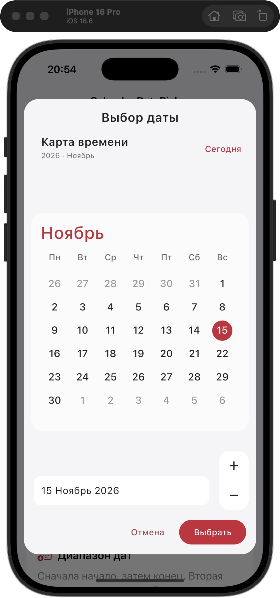
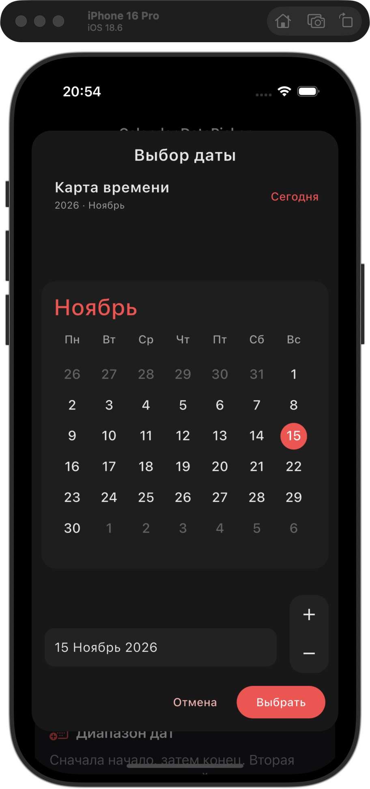
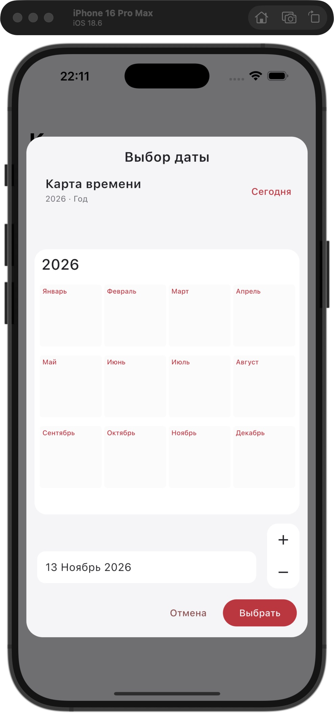
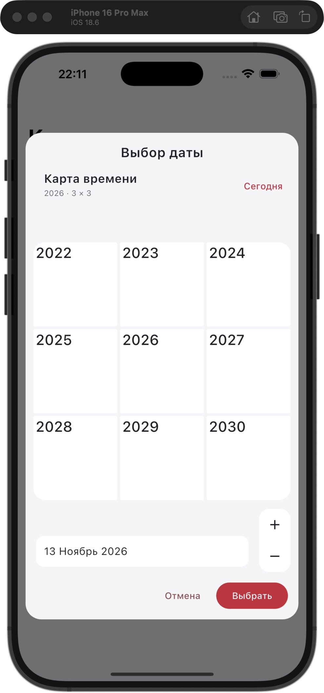

# Calendar DatePicker

A Flutter date picker that feels like navigating a map: pinch from a month to its year, then to a square of nine years. All dates share **one continuous coordinate system**—zoom changes the camera, not the screen.

[Подробное руководство на русском](https://github.com/AktanK13/Calendar_DatePicker/blob/main/doc/README.ru.md) · [API reference](https://github.com/AktanK13/Calendar_DatePicker/blob/main/doc/api.md) · [GitHub](https://github.com/AktanK13/Calendar_DatePicker)

## Preview

All screenshots show the same continuous canvas at different scales.

| Light month | Dark month |
| --- | --- |
|  |  |

| Year | Nine years |
| --- | --- |
|  |  |

## Is this the right picker for your app?

Use it for a **single Gregorian date** when spatial navigation and touch gestures are part of the experience. You can open a confirmation dialog or embed the map in an existing layout.

- A square, rounded canvas with month → year → nine-year camera levels.
- Direct pinch/pan input and interruptible camera settling.
- Today's year centered in its 3×3 overview.
- Inclusive date limits and a configurable finite year range.
- Light/dark themes, Russian/English labels and a configurable first weekday.
- Portrait/landscape layouts, keyboard navigation and visible-item semantics.
- No runtime dependencies other than the Flutter SDK.

It is **not** a time picker, date-range picker, infinite calendar, native UIKit control, or drop-in replacement for Flutter's constructor/API. The map is custom painted; its dialog and controls currently use Flutter Material internally. The example app uses Cupertino controls around the unchanged picker.

## Requirements and platform status

| Requirement | Value |
| --- | --- |
| Flutter | `>=3.41.0` |
| Dart | `>=3.11.0 <4.0.0` |
| Calendar | Gregorian, years `1…9999` |
| Selection | One date, no time component |

The example targets iOS and has been run on iPhone 16 Pro Max Simulator / iOS 18.6. Physical-device performance and full VoiceOver/TalkBack validation are pending.

## Installation

Add the package to your app:

```yaml
dependencies:
  flutter:
    sdk: flutter
  calendar_date_picker: ^0.2.0
```

```sh
flutter pub get
```

Source repository: [AktanK13/Calendar_DatePicker](https://github.com/AktanK13/Calendar_DatePicker).

Import the library:

```dart
import 'package:calendar_date_picker/calendar_date_picker.dart';
```

## Quick start: open from a button

This complete screen is intended to be placed under a `MaterialApp`:

```dart
import 'package:flutter/material.dart';
import 'package:calendar_date_picker/calendar_date_picker.dart';

class DateField extends StatefulWidget {
  const DateField({super.key});

  @override
  State<DateField> createState() => _DateFieldState();
}

class _DateFieldState extends State<DateField> {
  DateTime? _date;

  Future<void> _pickDate() async {
    final picked = await showCalendarMapDatePicker(
      context: context,
      initialDate: _date ?? DateTime.now(),
      firstYear: 1900,
      lastYear: 2100,
      locale: const Locale('en'),
    );
    if (!mounted || picked == null) return;
    setState(() => _date = picked);
  }

  @override
  Widget build(BuildContext context) => Column(
    mainAxisSize: MainAxisSize.min,
    children: [
      Text(_date == null ? 'No date selected' :
        '${_date!.year}-${_date!.month}-${_date!.day}'),
      FilledButton(onPressed: _pickDate, child: const Text('Choose date')),
    ],
  );
}
```

Tapping a day changes the temporary selection **inside the dialog**. “Select” returns that date as `Future<DateTime?>`; cancel, back, or tapping the barrier returns `null`. The initial date is already selected, so confirmation without tapping another day returns that initial/clamped date. Save the result in your own state and pass it back on the next opening.

Use a `BuildContext` below your app's `Navigator` and localizations. Passing the context that creates `MaterialApp` rather than a descendant context is a common integration mistake.

## Embedding the map

```dart
SizedBox(
  height: 560,
  width: double.infinity,
  child: CalendarMapDatePicker(
    initialDate: DateTime(2026, 11, 13),
    firstYear: 2020,
    lastYear: 2035,
    minDate: DateTime(2026, 1, 1),
    maxDate: DateTime(2027, 12, 31),
    locale: const Locale('en'),
    onDateSelected: (date) {
      // Save immediately. There is no confirmation step in the embedded widget.
    },
  ),
)
```

The parent must provide **finite width and height**. `Expanded` inside a bounded `Column`/`Row` also works. In a scrollable, use an explicit height. An unbounded map renders an empty box; it does not calculate intrinsic height.

`onDateSelected` is immediate and may run again when the same date is tapped. It is not called merely because the widget initializes or a constraint changes. Date selection never automatically closes an embedded map.

## Understanding the map

1. Open at the month containing `initialDate` (after clamping to selection limits).
2. Pinch out: month → containing year → nine-year overview.
3. Pinch in: overview → year near the gesture → month near the gesture.
4. Tap a year/month to approach it; tap a readable current-month date to select it.

One completed pinch moves at most one camera level. Changes smaller than roughly 12% settle back to the same level. The camera follows the gesture before it settles. Releasing one finger does not start settling while the other is still down.

At month level, panning is limited to the active year; releasing a swipe settles to the nearest month. At year level, the entire year fits, so panning cannot leave it. Overview panning explores the finite world and settles to a three-row window. The `+`/`−` buttons move between levels.

Years have three columns; months inside a year have four columns and three rows. Each month has a header, weekdays, and 42 day cells. Other-month dates are muted and not selectable in that tile.

### The centered current year

The system year is captured once when calendar geometry is first used. Leading grid slots place it in the middle column; the overview includes the row above and below it. For a 2026 anchor, returning to today's year and zooming out shows:

```text
2022  2023  2024
2025  2026  2027
2028  2029  2030
```

Changing `firstYear` does not push the current year into a corner. The layout remains fixed while you navigate. Other year overviews show three rows around the active row; only the captured current year is guaranteed to be the central tile. If the current year is outside the configured range, it is not rendered. At a range boundary, missing years stay empty rather than becoming selectable outside the allowed world.

The anchor does not relocate automatically at New Year during an existing app run. Restart the app to obtain a new system-year anchor; this prevents coordinates jumping mid-session.

“Today” shows the current month without changing the selected date. If today is outside the year range, it shows the closest date within that range. It may still show dates disabled by `minDate`/`maxDate`.

## Date limits and date values

```dart
minDate: DateTime(2026, 1, 1),
maxDate: DateTime(2026, 12, 31),
```

- Both limits are **inclusive** and compare year/month/day, ignoring time and the UTC flag.
- `firstYear`/`lastYear` define the map; `minDate`/`maxDate` define selectable days. Disabled days stay visible.
- Calendar arithmetic uses UTC to avoid daylight-saving-hour shifts.
- Returned selections are local `DateTime(year, month, day)` values without a time of day.
- Dates are treated as civil dates. The picker does not convert an input instant to a different timezone before reading its fields.

For example, `DateTime.utc(2026, 11, 13, 23)` means **November 13**, not a timezone-adjusted local day. If your backend stores instants, convert them to the intended user's timezone before passing their calendar date to the picker.

Construction throws `ArgumentError` for an invalid year interval, an initial year outside it, a weekday outside `1…7`, reversed min/max, constraints with no intersection with the year range, or custom label lists of the wrong lengths. An initial day outside min/max but inside the year range is clamped to a selectable day.

## Light and dark themes

With `theme: null` (the default), the picker uses the surrounding **Material** theme's brightness. You can also choose explicitly:

```dart
theme: CalendarMapTheme.light,
// or CalendarMapTheme.dark
```

A custom palette:

```dart
theme: const CalendarMapTheme(
  background: Color(0xFFF5F5F7),
  territory: Color(0xFFFFFFFF),
  text: Color(0xFF202124),
  secondary: Color(0xFF62656A),
  muted: Color(0xFF96999F),
  accent: Color(0xFFCB263A),
  onAccent: Color(0xFFFFFFFF),
),
```

Today is outlined and the selected day is filled. A selected day does not receive an additional focus border. Ensure your custom palette has adequate contrast for both states.

### Using a Cupertino app

The **host screen** can be entirely Cupertino, as in the bundled example. The picker still needs Material localizations for its existing dialog and controls. Provide those services and a matching inherited Material theme without replacing your Cupertino UI:

```dart
import 'package:flutter/cupertino.dart';
import 'package:flutter/material.dart' as material;

CupertinoApp(
  localizationsDelegates: const [
    material.DefaultMaterialLocalizations.delegate,
  ],
  builder: (context, child) => material.Theme(
    data: material.ThemeData(
      brightness: CupertinoTheme.of(context).brightness ?? Brightness.light,
    ),
    child: child!,
  ),
  home: const YourCupertinoScreen(),
)
```

`YourCupertinoScreen` is your app's widget. For automatic system-mode changes and matching accent colors, follow [example/lib/main.dart](https://github.com/AktanK13/Calendar_DatePicker/blob/main/example/lib/main.dart). This bridge does not make the picker a native UIKit dialog.

## Locale and first weekday

```dart
locale: const Locale('en'),
firstDayOfWeek: DateTime.sunday,
```

Defaults are Russian and Monday. `ru` uses Russian built-in labels; other language codes currently fall back to English. The first weekday is independent of locale.

The embedded widget accepts `labels: CalendarMapLabels(...)` with **12 month names** and **7 weekday names**, ordered Monday through Sunday, plus `today`, `zoomIn`, `zoomOut`, `hint`, and `map`. The dialog helper supports `title`, `confirmText`, and `cancelText`. Full `intl` formatting and RTL are not implemented.

## Animation and accessibility

The embedded widget exposes:

```dart
animationDuration: const Duration(milliseconds: 260),
animationCurve: const Cubic(.23, 1, .32, 1),
snapOnPinchEnd: true,
showZoomHint: true,
showZoomControls: true,
```

The initial month performs one subtle 8% zoom-out and return to explain pinch navigation. It lasts 260 ms in total, is skipped for reduced motion, and stops immediately when the user touches the map. Set `showZoomHint: false` to disable it. New input also interrupts ordinary camera transitions at their displayed position. `snapOnPinchEnd: false` disables automatic post-gesture settling; button/tap navigation still uses defined levels.

`MediaQuery.disableAnimations` makes programmatic camera changes immediate. Keyboard navigation is also immediate. Visible years, months, dates, and controls expose semantic labels/actions; a full screen-reader audit is still pending.

| Input | Action |
| --- | --- |
| Arrow left/right | Move date focus by one day |
| Arrow up/down | Move date focus by one week |
| Enter / Space | Select the focused date |
| Home | Show the closest selectable date to today |
| `+` / `−` | Move between zoom levels |
| Tab | Traverse standard controls |
| Vertical mouse wheel | Free zoom at pointer |
| Horizontal / Shift wheel | Pan |

Mouse wheel events do not trigger pinch settling. Trackpad behavior depends on whether the platform reports native pan/zoom events or ordinary wheel events.

## State, rebuilding, and rotation

- `initialDate` seeds state once; changing it on an existing state does not control selection or reset the camera.
- Rebuilding after a callback is safe. To reset completely, supply a new `Key`.
- Changing min/max clears an invalid existing selection without emitting a callback.
- Changing the year range rebuilds the navigation reference and focuses a valid month.
- Resizing preserves the selected date and level, then refits that level's target square; it does not preserve arbitrary intermediate pan offsets.
- Landscape moves controls beside the canvas. Orientation is not locked.

There is no external selection/camera controller on `CalendarMapDatePicker` yet. Exported geometry/camera utility classes are not attached to the widget's private camera automatically.

## API and example

See [the complete parameter tables and utility API](https://github.com/AktanK13/Calendar_DatePicker/blob/main/doc/api.md).

```sh
cd example
flutter pub get
flutter devices
flutter run -d <ios-simulator-id>
```

The Cupertino example demonstrates a regular dialog, custom “Yes / No” actions without +/− controls, immediate selection in a bottom sheet, and a two-step date range built from two map selections.

## Limitations

- Finite range; no infinite loading, native multi/range highlighting, events, time selection or non-Gregorian calendars. The example composes a range from two constrained selections.
- No momentum/inertial scrolling.
- Very small embedding areas may make dates hard to read; provide sufficient space.
- No automatic midnight refresh without another frame; the layout-year anchor is fixed for the app run.
- No guarantee of stable 60/120 FPS from debug-simulator measurements. Profile on target hardware.
- No completed physical-device or full VoiceOver/TalkBack validation.

## License

[MIT](https://github.com/AktanK13/Calendar_DatePicker/blob/main/LICENSE) © 2026 AktanK13.
